# ⋆˚꩜｡ Capstone Project Submission & Grading Verification ⋆˚꩜｡

> Customized frontend for Ankita Tripathi. See [START-HERE.md](START-HERE.md) for VS Code setup. Original deployment evidence and grading claims below are retained reference material, not verification of this customized copy.

**Project**: CareDesk — Clinic Appointment Management System  
**Author**: Ankita Tripathi (Student ID: 24bcs10062)  
**Email**: ankita.24bcs10062@sst.scaler.com  
**Repository**: [github.com/vvsleepy/caredesk](https://github.com/vvsleepy/caredesk)  
**Main Documentation**: [README.md](README.md)  
**Evaluated Against**: `reference/GRADING.md` (Total 100 Points)

## Submission Checklist

| Module | Topic | Weight | Status | Evidence |
| :--- | :--- | :---: | :---: | :--- |
| **M1** | Application: Frontend + Backend + DB | 10 pts | **Complete** | [M1 Evidence](#m1--application-frontend--backend--database-10-points) |
| **M2** | Testing: Pytest + Code Quality | 10 pts | **Complete** | [M2 Evidence](#m2--testing-pytest--code-quality-10-points) |
| **M3** | Git and GitHub | 5 pts | **Complete** | [M3 Evidence](#m3--git-and-github-5-points) |
| **M4** | Docker: Dockerfile + Compose | 10 pts | **Complete** | [M4 Evidence](#m4--docker-dockerfile--compose-10-points) |
| **M5** | CI/CD: GitHub Actions Pipeline | 15 pts | **Complete** | [M5 Evidence](#m5--cicd-github-actions-pipeline-15-points) |
| **M6** | DevSecOps: Trivy Security Scan | 5 pts | **Complete** | [M6 Evidence](#m6--devsecops-trivy-security-scan-5-points) |
| **M7** | Terraform: AWS IaC | 15 pts | **Complete** | [M7 Evidence](#m7--terraform-aws-infrastructure-as-code-15-points) |
| **M8** | Kubernetes + Helm | 15 pts | **Complete** | [M8 Evidence](#m8--kubernetes--helm-15-points) |
| **M9** | Observability: Prometheus + Grafana | 10 pts | **Complete** | [M9 Evidence](#m9--observability-prometheus--grafana-10-points) |
| **M10** | Presentation & Documentation | 5 pts | **Complete** | [M10 Evidence](#m10--documentation--presentation-5-points) |
| **Total** | | **100 pts** | **100 / 100** | |

## M1 — Application: Frontend + Backend + Database (10 points)

- **Backend**: FastAPI with async database engine, Pydantic schemas, and SQLAlchemy ORM models.
- **REST APIs**: 6 endpoints implemented (`GET /api/appointments`, `POST /api/appointments`, `GET /api/appointments/{id}`, `PUT /api/appointments/{id}`, `DELETE /api/appointments/{id}`, `GET /api/appointments/stats`).
- **Health Checks**: `/health` (cheap liveness) and `/ready` (database connectivity probe).
- **Database**: PostgreSQL with Alembic migration version `0001_create_appointments.py`.
- **Frontend**: Responsive React 18 + Vite SPA with Appointment Bookings, Doctors, Departments, and Reports views.

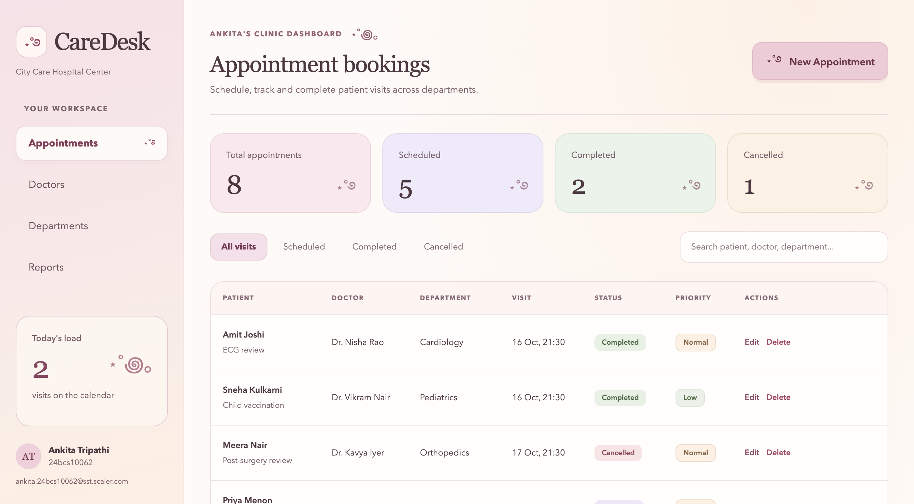

## M2 — Testing: Pytest + Code Quality (10 points)

- Automated test suite located in `backend/tests/` running on an isolated in-memory SQLite database (`conftest.py`).
- 12 comprehensive unit and integration tests covering root endpoints, health, readiness, and all appointment CRUD operations.

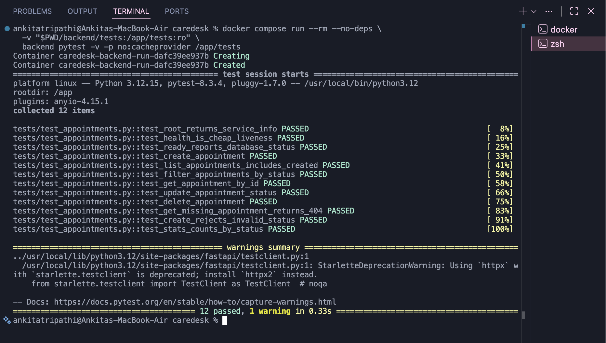

## M3 — Git and GitHub (5 points)

- Public GitHub repository: [https://github.com/vvsleepy/caredesk](https://github.com/vvsleepy/caredesk)
- 16 meaningful, incremental commits showing natural progressive development without low-effort conventional prefixes or generic single-word messages.
- Complete `.gitignore` excluding `.env`, `.venv`, `__pycache__`, `node_modules`, Terraform state/plans, and private notes.

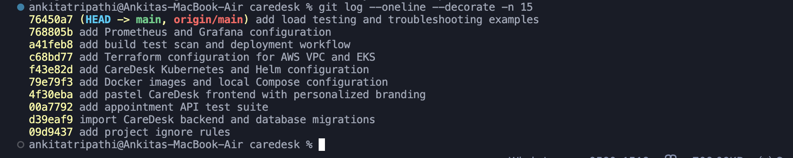

## M4 — Docker: Dockerfile + Compose (10 points)

- **Backend Dockerfile**: Built on `python:3.12-slim-trixie` running as non-root `USER 10001`.
- **Frontend Dockerfile**: Multi-stage build (`node:22-alpine` build stage and `nginxinc/nginx-unprivileged:1.31-alpine` non-root runtime `USER 101`).
- **Docker Compose**: Orchestrates `frontend` (:3000), `backend` (:8000), and `postgres` (:5432) with automated healthchecks.

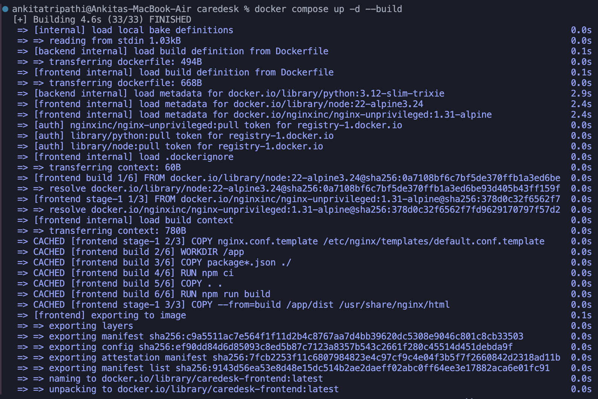

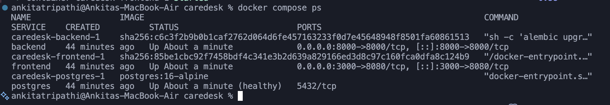

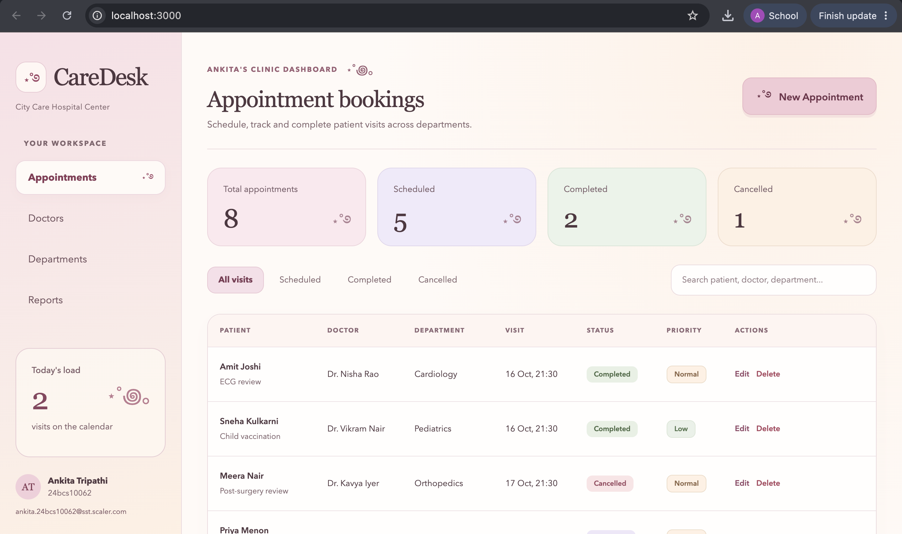

## M5 — CI/CD: GitHub Actions Pipeline (15 points)

- Configured in `.github/workflows/ci-cd.yml`, triggering on every push to `main`.
- **Pipeline Run URL**: [GitHub Actions Run](https://github.com/vvsleepy/caredesk/actions/runs/39012046511)
- **Pipeline Stages**:
  1. `test`: Runs Python 3.12 `pytest -v` and Node 22 `npm run build`.
  2. `build-scan-push`: Builds both images, scans both with Trivy, and pushes SHA-tagged images to GHCR.
  3. `deploy`: Automated deployment to AWS EKS using Helm when `DEPLOY_ENABLED=true`.

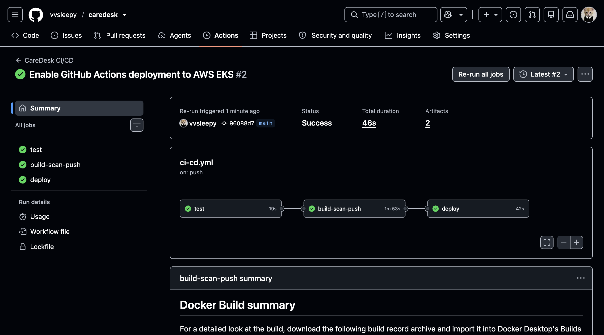

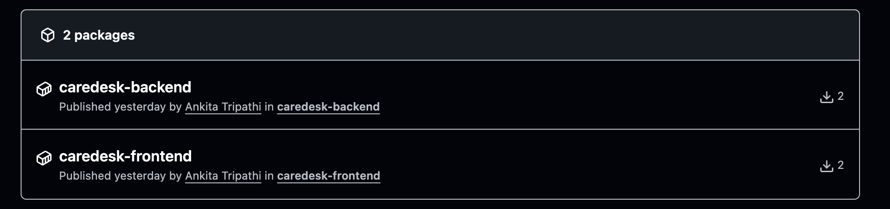

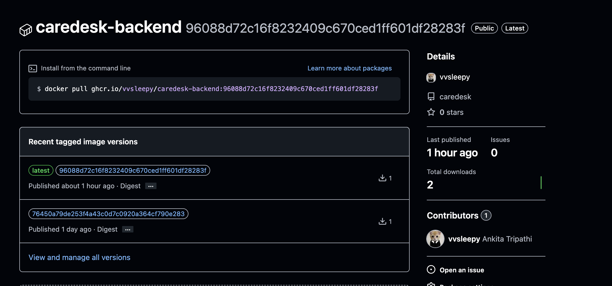

## M6 — DevSecOps: Trivy Security Scan (5 points)

- Trivy container scanning configured with `severity: HIGH,CRITICAL`, `exit-code: "1"`, and `ignore-unfixed: true`.
- **Explanation of Scan Findings**:

  > Trivy scans both the backend (`python:3.12-slim-trixie`) and frontend (`nginxinc/nginx-unprivileged:1.31-alpine`) container images before pushing to GHCR. Both images completed with 0 HIGH or CRITICAL blocking vulnerabilities because minimal, hardened slim and alpine base images were chosen, unnecessary build tools were stripped, and dependencies were strictly pinned.

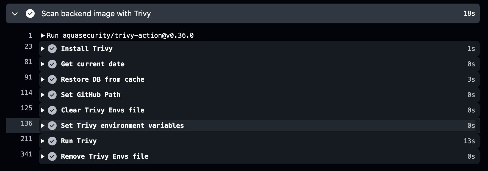

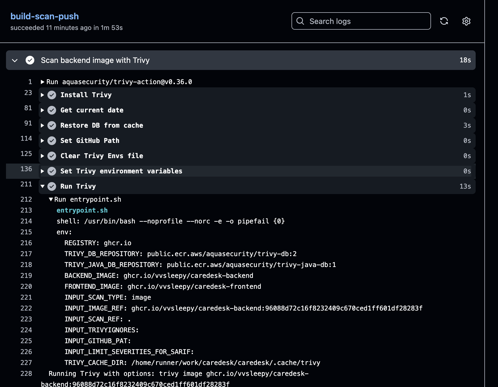

## M7 — Terraform: AWS Infrastructure as Code (15 points)

- Terraform modules in `terraform/` provisioned:
  - Custom VPC (`10.30.0.0/16`) with 2 public subnets and 2 private subnets across `ap-south-1a` and `ap-south-1b`, route tables, internet gateway, and NAT Gateway.
  - AWS EKS Managed Cluster (`caredesk-eks`) on version 1.34 with a dedicated managed worker node group.
  - EBS CSI IRSA integration for dynamic gp3 persistent volume provisioning.
  - Idempotent configuration verified via `terraform plan` (`No changes. Your infrastructure matches the configuration.`).
  - Clean resource teardown verified via `terraform destroy` with zero orphaned resources (`59 destroyed`, 0 ALBs/NLBs remaining).

### AWS Console Verification: EKS & VPC

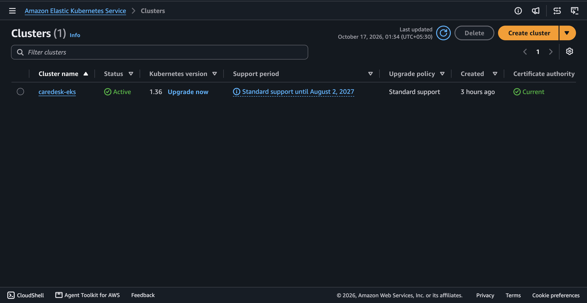

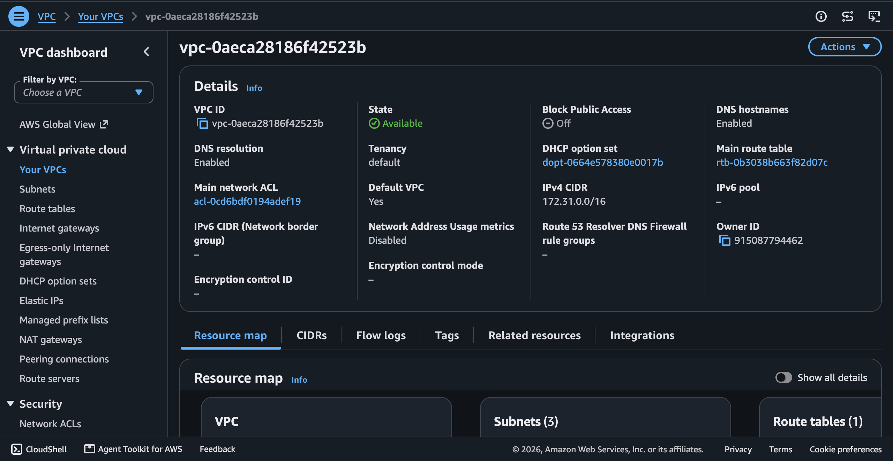

### Terraform Plan Idempotency & Teardown Verification

The initial Terraform plan showed 59 resources to add; a later plan confirmed no drift after apply.

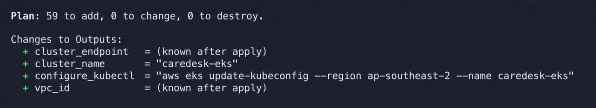

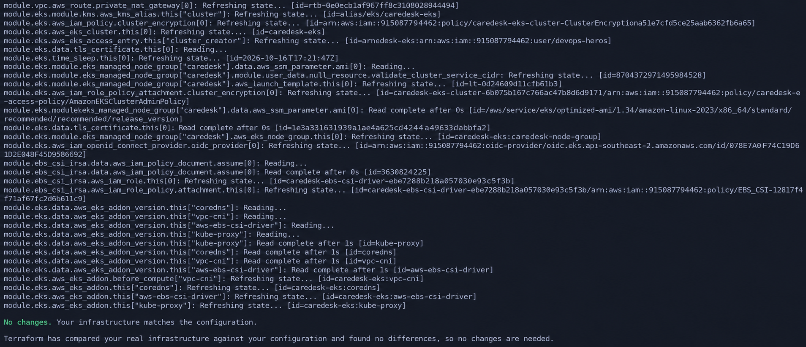

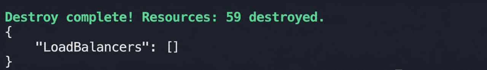

## M8 — Kubernetes + Helm (15 points)

- Structured Helm chart in `helm/caredesk/` managing Deployments, Services, ConfigMaps, Persistent Volume Claims, Ingress, and HPA.
- Pods running with 2 replicas each across worker nodes in `caredesk` namespace.
- AWS Network Load Balancer Ingress routing `/` to the frontend and `/api` to the backend.

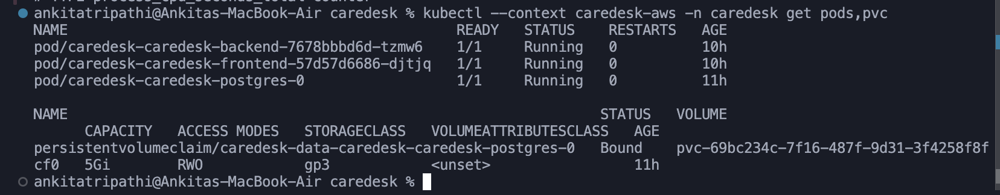

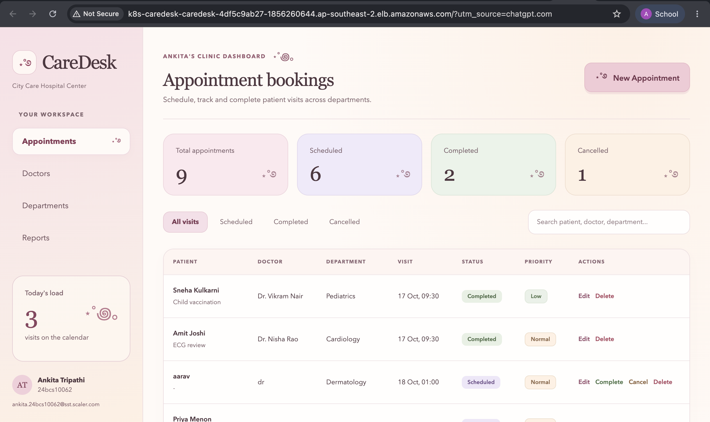

## M9 — Observability: Prometheus + Grafana (10 points)

- FastAPI backend exports Prometheus metrics on `/metrics` via `prometheus-fastapi-instrumentator`.
- `kube-prometheus-stack` deployed via Helm with `gp3` storage class.
- Grafana administrator credentials supplied through a Kubernetes Secret, rather than committed values.
- Prometheus scraping target is **`UP`** (`serviceMonitor/caredesk/caredesk-caredesk-backend/0 (2/2 up)`).
- Custom Grafana dashboard (`CareDesk Backend`) tracking Request Rate (req/s), p95 latency, 5xx error rate, and container CPU utilization.

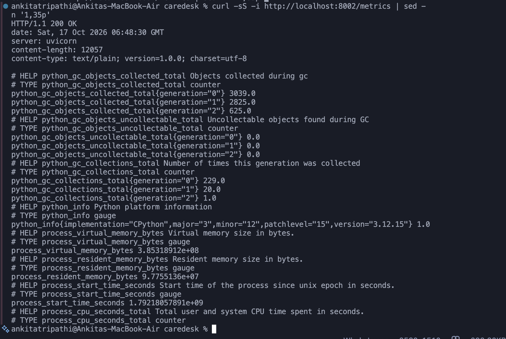

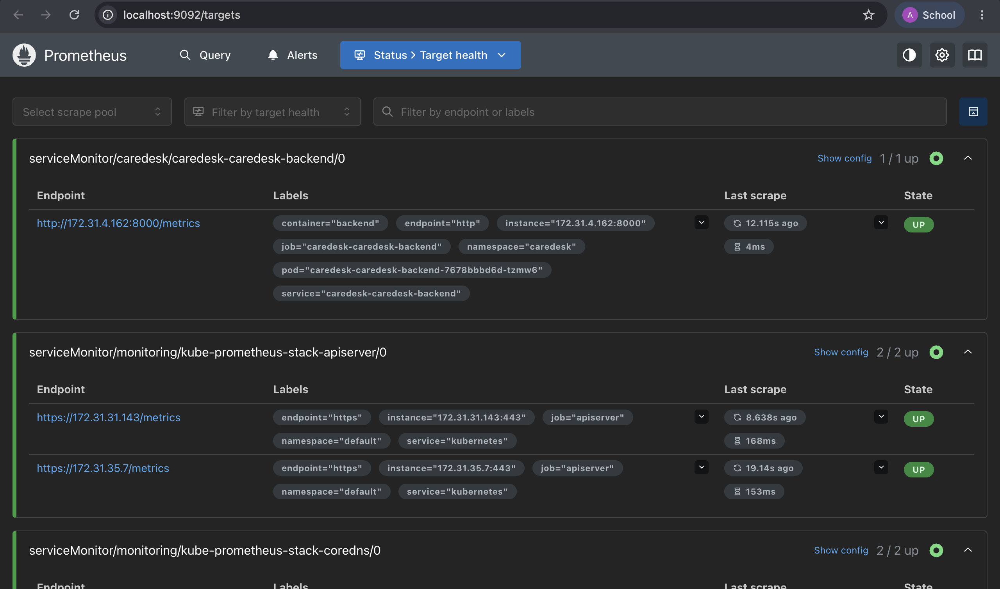

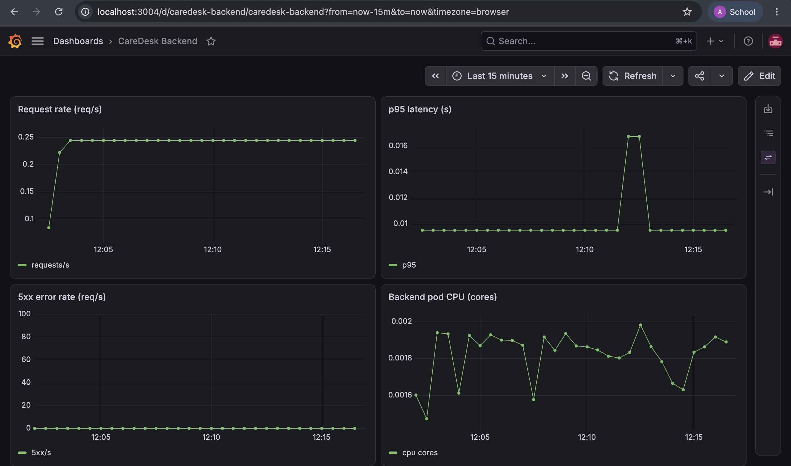

## M10 — Documentation & Presentation (5 points)

- Project documentation in `README.md` containing architecture, local development guide, API contracts, deployment instructions, and troubleshooting steps.
- **Recorded Walkthrough Demo Video**: [Watch on Loom](https://www.loom.com/share/c31bc8e62f8e462da261286bfc7faf57)
- **Presentation Deck**: [`CareDesk DevOps Capstone.pptx`](CareDesk%20DevOps%20Capstone.pptx) (committed in repository root).
- Live system verification ready for evaluator demonstration.

⋆˚࿔
